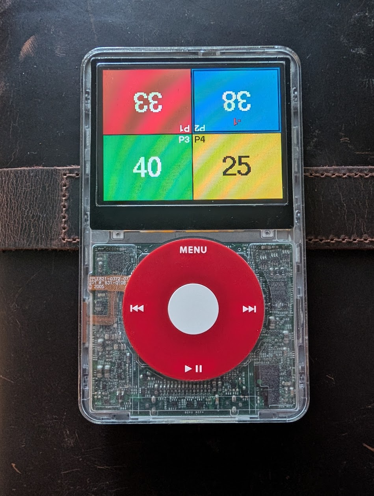
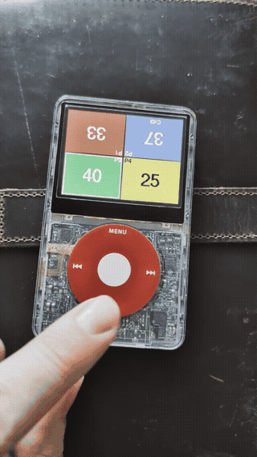

# iPod MTG Life

A **Magic: The Gathering** life & counter tracker as a [Rockbox](https://www.rockbox.org/)
plugin for the **iPod 5th generation (iPod Video)**, driven entirely by the click wheel.

<p align="center">
  
</p>
<p align="center">
  <br>
  <em>PLAY rolls for first player</em>
</p>

## Features

- **Up to 6 players**, screen auto-tiled with no wasted space:
  - 2 players — top / bottom halves
  - 3 players — two quarter panels on top, one half-width panel on the bottom
  - 4 players — 2×2
  - 5 players — two on top, three on the bottom
  - 6 players — 3×3
- **Per-player colors** (full-cell backgrounds; text auto-contrasts black/white).
- **Big bold life totals** (loads bundled Adobe-Helvetica-Bold, falls back to the UI font).
- **Life feedback**: a brief green (up) / red (down) flash plus a running **+N / −N tally**
  that holds and then fades out a few seconds after the last change.
- **Per-player counters**: poison, energy, experience, commander tax, and
  **per-opponent commander damage** (flags lethal at 21; poison at 10).
- **Dice roller** built in (d2, d4, d6, d8, d10, d12, d20, d100).
- Player count and starting life **persist** between launches.

## Controls (click wheel)

| Action | Does |
|--------|------|
| **Scroll** | Move the highlight between players (grid) / change the selected value |
| **SELECT** | Enter the highlighted player (scroll then changes life); press again for the counter list |
| **MENU (tap)** | Go back one level |
| **MENU (hold)** | Main menu: number of players, starting life, roll dice, reset life, quit |

## Repo contents

| File | Purpose |
|------|---------|
| `mtglife.c` | The entire plugin (single source file) |
| `install.sh` | Copies the plugin into a Rockbox source tree and registers it in the build |
| `LICENSE` | GPLv2 (same license as Rockbox) |

---

## ⚠️ Match your Rockbox version first

Rockbox plugins embed a **plugin API version** that must match the firmware on your
device. If it doesn't, the plugin fails to launch with **"incompatible version"**.

Check what your device runs — open `/.rockbox/rockbox-info.txt` on the player and read
the `Version:` line (e.g. `4.0`). Then build this plugin against **that same release**,
by checking out its tag before building (release tags look like `v4.0-final`):

```sh
git checkout v4.0-final      # use YOUR device's version
```

(Alternatively, update your device to whatever Rockbox revision you compile against.)

---

## Build & install

### 1. Get the Rockbox source

```sh
git clone https://github.com/Rockbox/rockbox
cd rockbox
git checkout v4.0-final       # <-- match your device (see above)
```

### 2. Get a cross-compiler (one-time)

Rockbox builds the device binary with its own `arm-elf-eabi-gcc`, installed by
`tools/rockboxdev.sh` (pick target **`a`** = arm).

**Linux:**
```sh
sudo apt install build-essential git texinfo automake libtool flex bison
tools/rockboxdev.sh --target=a --prefix="$HOME/rockbox-toolchain"
export PATH="$HOME/rockbox-toolchain/bin:$PATH"
```

**macOS (Apple Silicon):** the script needs GNU tools and benefits from fewer parallel
jobs (gcc can exhaust RAM otherwise):
```sh
brew install texinfo gnu-sed coreutils automake
RBDEV_PARALLEL=4 \
  PATH="/opt/homebrew/opt/coreutils/libexec/gnubin:/opt/homebrew/opt/gnu-sed/libexec/gnubin:/opt/homebrew/opt/texinfo/bin:/opt/homebrew/bin:$PATH" \
  tools/rockboxdev.sh --target=a --prefix="$HOME/rockbox-toolchain"
export PATH="$HOME/rockbox-toolchain/bin:$PATH"
```

### 3. Add the plugin

```sh
/path/to/this-repo/install.sh /path/to/rockbox
```

### 4a. Build for the device (iPod Video)

```sh
mkdir build-ipod && cd build-ipod
../tools/configure --target=ipodvideo --type=n
make -j rocks
```

Then copy it onto the iPod in **USB disk mode**:
```sh
cp apps/plugins/mtglife.rock "/Volumes/<YOUR IPOD>/.rockbox/rocks/games/"
```
On the device, launch via **Plugins → Games → mtglife**.

### 4b. Build the desktop simulator (for development)

```sh
mkdir build-sim && cd build-sim
../tools/configure --target=ipodvideo --type=s
make -j && make fullinstall
./rockboxui
```
Keyboard: **↑/↓** = wheel, **Return** = SELECT, **Esc** = MENU (tap = back, hold = menu).

> macOS note: the simulator is built with a native Homebrew gcc, and `configure` may
> expect a specific version (e.g. `gcc-16`). If it reports the compiler isn't on your
> PATH, either `brew install gcc` or symlink the installed `gcc-NN` to the expected name
> on your PATH.

---

## Customizing

Everything lives in `mtglife.c`:

| What | Where |
|------|-------|
| Player colors | `PLAYER_RGB[]` |
| Default players / starting life | `DEFAULT_PLAYERS`, `DEFAULT_LIFE` |
| Screen layouts | `grid_layout()` |
| Counters (incl. per-opponent commander damage) | `build_counter_list()` |
| Fonts | `font_big` / `font_med` (paths set in `plugin_start()`) |
| Flash / tally timing | `ANIM_PULSE`, `ANIM_HOLD`, `ANIM_FADE` |
| Lethal thresholds | `POISON_LETHAL`, `CMD_LETHAL` |

### Bigger numbers / a custom font

Rockbox's bundled fonts top out around 35 px. For larger digits — or an MTG-style
typeface — convert a TrueType font to a Rockbox bitmap font and point `font_big` /
`font_med` at it:
```sh
tools/convttf -s 50 YourFont.ttf        # produces a .fnt
# install the .fnt under /.rockbox/fonts/ on the device (or in the sim's simdisk)
```
Note: the official MTG "Beleren" typeface is proprietary to Wizards of the Coast —
supply your own licensed copy; it is not included here.

---

## License

GPLv2 (see [`LICENSE`](LICENSE)), matching Rockbox. `mtglife.c` carries the standard
Rockbox GPL header. This project is not affiliated with or endorsed by Wizards of the
Coast; "Magic: The Gathering" is their trademark.
